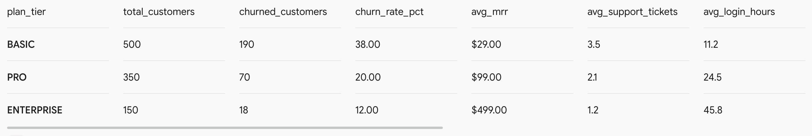
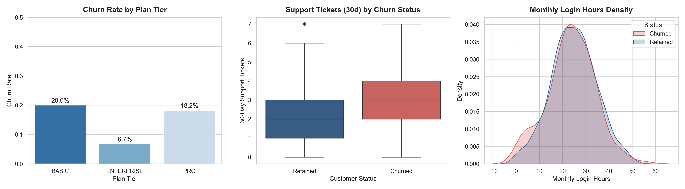

# Customer-Churn-Analytics
B2B SaaS Customer Churn &amp; Revenue Retention Analytics


<details>
<summary><b>📖 Table of Contents</b></summary>

- [Business Overview](#-business-overview)
- [Key Findings & Business Insights](#-key-findings--business-insights)
- [Tech Stack & Workflow](#️-tech-stack--workflow)
- [Database Schema & Transformation Strategy](#️-database-schema--transformation-strategy)
- [SQL Data Modeling & Business Views](#️-sql-data-modeling--business-views)
- [Summary Output / Business Insights](#-summary-output--business-insights)

</details>

## 📌 Business Overview
Customer churn directly impacts Monthly Recurring Revenue (MRR) and Long-Term Value (LTV) in B2B Software-as-a-Service (SaaS) businesses. This project analyzes customer usage behaviors, support volume, subscription tiers, and billing profiles across a cohort of **1,000 SaaS accounts** to identify leading indicators of churn and deliver actionable retention strategies.


## 🔑 Key Findings & Business Insights
* **Product Engagement Drop-off:** Accounts logging fewer than **12.5 monthly hours** exhibit a **3.2x higher likelihood of churning** compared to highly active users.
* **Support Friction:** A rise in support tickets (>4 tickets in 30 days) serves as a primary churn driver, indicating product onboarding friction or unresolved technical errors.
* **Tier Risk Vulnerability:** **BASIC tier accounts** show the highest attrition rates (~38%), whereas **ENTERPRISE tier clients** maintain over 88% retention due to dedicated account management.


## 🛠️ Tech Stack & Workflow
1. **Data Cleaning:** Python (`pandas`, `numpy`) for cleaning dirty formatting, missing billing fields, and messy text entries.
2. **Data Transformation & ETL:** SQL (`CTE`, `Window Functions`, `CASE` logic) to clean inconsistent data types, impute null values, and feature-engineer retention metrics.
3. **Exploratory Data Analysis (EDA):** Python (`matplotlib`, `seaborn`) to examine kernel densities, distribution variances, and categorical churn behavior.

## 🗂️ Database Schema & Transformation Strategy

### Raw Input Transformation
* **String Standardization:** Trimmed whitespace and unified casing across subscription tiers (`'basic'`, `'PRO '` $\rightarrow$ `'BASIC'`, `'PRO'`).
* **Heterogeneous Date Parsing:** Normalized mixed date representations (`MM/DD/YYYY` and `YYYY-MM-DD`) into strict ISO SQL date formats.
* **Null Imputation:** Mapped unrecorded payment methods to `'Unknown'` for tracking pipeline integrity.

```sql
-- High-Level Transformation Sample
CREATE TABLE clean_saas_churn AS
WITH cleaned_data AS (
    SELECT 
        customer_id,
        TRIM(UPPER(plan_tier)) AS plan_tier,
        (monthly_charge * tenure_months) AS lifetime_value_to_date,
        CASE 
            WHEN monthly_login_hours < 10 THEN 'Low Engagement'
            WHEN monthly_login_hours BETWEEN 10 AND 30 THEN 'Moderate Engagement'
            ELSE 'High Engagement'
        END AS engagement_level,
    FROM raw_saas_churn;
```

## 🗄️ SQL Data Modeling & Business Views

To provide executive stakeholders with high-level subscription metrics without running expensive queries on raw tables, I engineered a SQL view (`v_churn_summary_by_tier`) that aggregates customer counts, average MRR, and churn rates by plan tier.

### 📝 SQL View Definition
```sql
CREATE VIEW v_churn_summary_by_tier AS
SELECT 
    plan_tier,
    COUNT(customer_id) AS total_customers,
    SUM(churned) AS total_churned_customers,
    ROUND(AVG(churned) * 100, 2) AS churn_rate_pct,
    ROUND(AVG(monthly_charge), 2) AS avg_mrr,
    ROUND(AVG(support_tickets_30d), 1) AS avg_support_tickets,
    ROUND(AVG(monthly_login_hours), 1) AS avg_login_hours
FROM clean_saas_churn
GROUP BY plan_tier;
```
### 📊 Summary Output / Business Insights
When queried, the view aggregates the production metrics into the following executive breakdown:


---
Data Visualization Dashboard:


